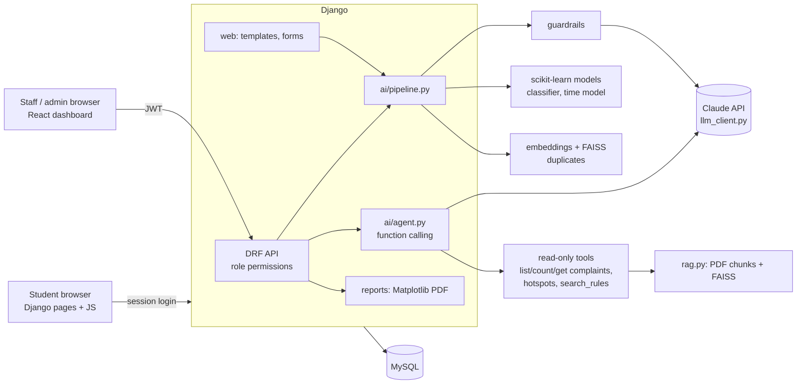

# CampusFix

AI complaint system for a college campus. Students report problems (hostel, mess, Wi-Fi,
labs, transport, ...) in **English, Tamil, Malayalam or a mix**. AI reads each complaint, finds
the category, urgency and location, sends it to the right department, merges duplicates and
predicts how long the fix will take. Staff and admins work from a React dashboard.

> **⚠ The data in this repository is SYNTHETIC.** `backend/data/sample_complaints.csv`
> (300 complaints) is generated from templates by `backend/data/generate_sample_data.py`, and
> the rule PDFs in `backend/data/rules/` are made-up sample rules. The model scores below are
> high *because* the data is templated; expect lower numbers on real complaints. Real
> complaints from the Google Form pilot go into `backend/data/real_complaints.csv`
> (see [Using real data](#using-real-data)).

---

## Contents

1. [What it does](#what-it-does)
2. [Architecture](#architecture)
3. [Setup](#setup) (Docker or local)
4. [Using the app](#using-the-app)
5. [AI pipeline](#ai-pipeline)
6. [REST API](#rest-api)
7. [Running the tests](#running-the-tests)
8. [Retraining the models](#retraining-the-models)
9. [Using real data](#using-real-data)
10. [Deploy to Render](#deploy-to-render)
11. [What I would improve](#what-i-would-improve)

---

## What it does

| Role | Where | Can do |
|---|---|---|
| **student** | Django site `/` | register, log in, submit complaints, track status (live refresh), edit/delete while open, rate the fix |
| **staff** | React dashboard `/dashboard/` | see and update **their department's** complaints, charts, hotspots, spike alerts, chat assistant |
| **admin** | React dashboard + Django admin | everything: all complaints, re-routing, AI metrics, weekly PDF report, upload rule PDFs |

| Tech | Job in the project |
|---|---|
| Python 3.11, Django 5.1 | backend, ORM only (no hand-written SQL) |
| MySQL 8 (utf8mb4) | main database; SQLite only for tests / quick demos |
| Django templates + CSS + JS | student pages; `forms.js` validates forms, `status.js` refreshes status live |
| Django REST Framework + simplejwt | JSON API with JWT login and role permissions |
| React 18 + Vite + Recharts | officials' dashboard |
| Claude (Anthropic SDK) | LLM intake (structured JSON), function-calling chat agent, RAG answers |
| scikit-learn | TF-IDF + Logistic Regression, Random Forest, DBSCAN, Isolation Forest |
| FAISS + embeddings | duplicate detection, document search |
| pypdf | reading rule PDFs |
| Matplotlib | weekly PDF report (and the sample rule PDFs) |
| pytest | 199 tests (backend) |
| Docker, docker-compose, gunicorn, WhiteNoise | running and deploying |

## Architecture



The same picture as text:

```
 Student (HTML/CSS/JS) ──session──┐                ┌──> Claude API (intake JSON, chat tools)
                                   ▼                │
 Staff/Admin (React) ──JWT──> Django + DRF ──> AI pipeline ──> scikit-learn models (.joblib)
                                   │           guardrails       FAISS (duplicates, rule search)
                                   │           agent / RAG      Matplotlib (weekly PDF)
                                   ▼
                                 MySQL
```

### Folder structure

```
CampusFix/
  backend/
    manage.py
    config/            settings (from .env), urls, api_urls, settings_test (SQLite)
    accounts/          custom User (role + department), forms, JWT serializers, auth API
    complaints/        models, services.py (all business rules), serializers, API, admin
    ai/
      llm_client.py    one wrapper for the LLM provider (provider/model/key from .env), call logging
      intake.py        prompt + JSON schema, validation, 1 retry, rule-based fallback
      guardrails.py    spam, abuse, prompt injection, off-topic, rate limit
      embeddings.py    embeddings + FAISS duplicate search
      rag.py           PDF -> chunks -> embeddings -> FAISS (+ keyword re-rank), answers cite file/page
      agent.py         function calling: the LLM calls safe read-only functions, never SQL
      pipeline.py      the complaint pipeline (steps 1-6 below)
      campus.py        campus map: place -> block + x/y metres
      ml/              train_classifier, train_time_model, hotspots, spikes, evaluate
      management/      train_models, load_sample_data, ingest_documents
    reports/           Matplotlib charts + weekly PDF, API, weekly_report command
    web/               Django templates, static css/js, views for student pages
    data/              generate_sample_data.py, sample_complaints.csv, rules/*.pdf
    tests/             pytest
  frontend/            React + Vite dashboard (src/pages, src/components)
  Dockerfile           production image (builds React, runs gunicorn)
  docker-compose.yml   MySQL + Django (dev) + Vite (dev), optional "prod" profile
  render.yaml          Render blueprint
  .env.example
```

### Database tables

`users`, `departments`, `complaints`, `complaint_status_history`, `duplicate_links`, `feedback`,
`documents`, `document_chunks`, `chat_history`, `model_metrics`, `llm_calls`.

## Setup

### Option A: Docker (recommended)

```bash
cp .env.example .env
#   set DJANGO_SECRET_KEY, DB_PASSWORD, MYSQL_ROOT_PASSWORD
#   optional: ANTHROPIC_API_KEY (without it the app uses the classifier instead of the LLM)
docker compose up --build
```

| URL | What |
|---|---|
| http://localhost:8000 | student website |
| http://localhost:5173/dashboard/ | React dashboard (Vite dev server, live reload) |
| http://localhost:8000/admin/ | Django admin |

On first start the backend migrates the database, seeds the 8 departments, trains and
evaluates the ML models, and (because `SEED_DEMO_DATA=1`) loads the 300 synthetic complaints
and the sample rule PDFs.

Create accounts:

```bash
docker compose exec backend python manage.py createsuperuser        # an admin
# Staff: Django admin -> Users -> add user -> role "Staff" + a department
# Students register themselves on the website.
```

To run the **production image** locally (gunicorn, built dashboard served by Django at `/dashboard/`):

```bash
docker compose --profile prod up --build app db     # http://localhost:8080
```

### Option B: local Python + Node

```bash
python3.11 -m venv .venv && source .venv/bin/activate
pip install -r backend/requirements.txt
cp .env.example .env          # DB_ENGINE=sqlite for a quick try without MySQL

cd backend
python manage.py migrate
python manage.py train_models          # trains + evaluates (a few seconds)
python manage.py load_sample_data      # optional: 300 synthetic complaints
python manage.py ingest_documents      # optional: sample rule PDFs for the assistant
python manage.py createsuperuser
python manage.py runserver             # http://localhost:8000

# dashboard, in another terminal
cd frontend
npm install
npm run dev                            # http://localhost:5173/dashboard/
# or: npm run build -> Django serves it at http://localhost:8000/dashboard/
```

### Settings (.env)

Everything secret or environment-specific lives in `.env` (see `.env.example`); nothing is
hard-coded. Main ones:

| Variable | Meaning |
|---|---|
| `DJANGO_SECRET_KEY`, `DJANGO_DEBUG`, `DJANGO_ALLOWED_HOSTS`, `CSRF_TRUSTED_ORIGINS` | Django basics |
| `DB_ENGINE` (`mysql`/`sqlite`), `DB_NAME`, `DB_USER`, `DB_PASSWORD`, `DB_HOST`, `DB_PORT` | database |
| `LLM_PROVIDER` (`anthropic`/`none`), `ANTHROPIC_API_KEY`, `LLM_MODEL`, `LLM_EFFORT` | LLM |
| `LLM_FALLBACKS` | `default` = a request the model declines is retried server-side on a fallback model |
| `LLM_INPUT_COST_PER_MTOK`, `LLM_OUTPUT_COST_PER_MTOK` | prices for the cost metric |
| `EMBEDDING_PROVIDER` (`local`/`sentence-transformers`), `DUPLICATE_THRESHOLD` (0.85) | embeddings |
| `JWT_ACCESS_MINUTES`, `JWT_REFRESH_DAYS`, `AUTH_THROTTLE_RATE` | API login |
| `SEED_DEMO_DATA` | load synthetic data on container start |

## Using the app

**Students** register at `/register/`, submit a complaint at `/complaints/new/` (any language)
and follow it at `/complaints/`. Statuses refresh by themselves every 15 seconds. After a fix
they can rate it 1–5.

**Staff/admins** log in at `/dashboard/`:

- **Complaints**: search, filter (status, category, urgency, needs review), sort, page; click a
  row for details, AI results, history, and to change status (with a note), urgency or (admin)
  category.
- **Charts**: totals, complaints per category, per block, weekly trend; every chart has a
  table view. Admins download the **weekly PDF report** here.
- **Hotspots**: DBSCAN clusters ("18 Wi-Fi complaints at A/B Block hostels").
- **Spike alerts**: hours with unusually many complaints.
- **Assistant**: ask "how many open IT complaints?" or "when do hostel gates close?".
- **AI metrics** (admin): classifier vs LLM accuracy, confusion matrix, time-model error,
  LLM latency and cost.
- **Rule documents** (admin): upload or delete PDFs for the assistant.

Complaint workflow (enforced in `complaints/services.py` for the web pages, the API and the admin):

```
open ──► in_progress ──► resolved ──► closed
 │  ▲          │             │
 │  └──────────┘             └──► in_progress (reopen)
 ├──► resolved
 └──► rejected
```

Every change is written to `complaint_status_history` (who, when, note).

## AI pipeline

When a complaint is submitted (`ai/pipeline.py`):

1. **Guardrails** (`guardrails.py`): blocks links/spam, repeated text, strong abuse, prompt
   injection ("ignore previous instructions"), off-topic text (no campus words *and* low
   classifier confidence), more than 5 complaints an hour, and the same text twice in a day.
   The student gets a clear message. Blocked text never reaches the LLM.
2. **LLM intake** (`intake.py`): Claude returns `{category, urgency, location, summary, language}`
   using **structured output** (a JSON schema in the request). We validate it again with
   `jsonschema` (enums, lengths) and **retry once** with the error message if it is invalid.
   The prompt has department descriptions, an urgency rubric, three multilingual examples, and
   fences the complaint in `<complaint>` tags as untrusted data.
3. **Classifier** (`ml/train_classifier.py`): TF-IDF (character 2–5-grams + word 1–2-grams, so
   Tamil, Malayalam and Tanglish work) + Logistic Regression. If it disagrees with the LLM, the
   complaint gets `needs_review = True`.
4. **Duplicates** (`embeddings.py`): the complaint is embedded and compared with FAISS against
   open complaints from the last 30 days in the same block. Cosine similarity ≥ 0.85 →
   a row in `duplicate_links` and `duplicate_count + 1` on the original.
5. **Time prediction** (`ml/train_time_model.py`): Random Forest on category, urgency, block,
   hour, weekday and text length → `predicted_days`.
6. **Save** everything. **If the LLM is off or fails, the classifier decides** (and simple rules
   guess urgency, language and location), so submission never breaks.

**Chat assistant** (`agent.py`, staff/admin): Claude gets five tools: `list_complaints`,
`count_complaints`, `get_complaint`, `top_hotspots`, `search_rules`. All are read-only and run
through `visible_complaints(user)`, so staff only ever see their department. Tool inputs from
the model are validated before use. Rule questions are answered from `search_rules` (RAG) and
cite `(file, page N)`. Off-topic questions are refused before calling the LLM. Every message
and tool call is saved in `chat_history`. If the LLM is down, the assistant shows the most
relevant rule passages instead.

**RAG** (`rag.py`): PDF → text per page → ~500-character chunks with 100-character overlap →
embeddings → FAISS. Search takes the closest chunks and re-ranks them by embedding similarity
+ keyword overlap.

**Embeddings**: the default `local` embedder hashes character n-grams into 2048 numbers. It is
free, offline and works for every script, and is very good at near-duplicates. For paraphrase
matching, `pip install sentence-transformers` and set `EMBEDDING_PROVIDER=sentence-transformers`
(multilingual MiniLM).

**LLM cost and latency**: every call is logged in `llm_calls` (purpose, model, latency, tokens,
cost) and shown on the metrics page. `LLM_EFFORT=low` keeps intake cheap.

Current scores (synthetic data, 20% held-out test set):

| Model | Result |
|---|---|
| Classifier | accuracy 0.98, macro precision 0.99, recall 0.98 |
| Time model | MAE 0.73 days (always guessing the average: 1.40 days), R² 0.62 |

## REST API

All endpoints except register/login/refresh need `Authorization: Bearer <access token>`.

| Method & path | Who | Notes |
|---|---|---|
| `POST /api/auth/register/` | anyone | always creates a student; rate-limited |
| `POST /api/auth/login/` | anyone | `{access, refresh, user}`; token carries `role`; rate-limited |
| `POST /api/auth/refresh/` | anyone | new access token |
| `GET /api/auth/me/` | logged in | current user |
| `GET /api/departments/` | logged in | the 8 departments |
| `GET /api/complaints/` | logged in | student: own · staff: department · admin: all. Filters `status, category, urgency, department, block, needs_review, q, from, to, ordering`; 20 per page |
| `POST /api/complaints/` | student | runs the AI pipeline; guardrail block → 400 `{detail, code}` |
| `GET /api/complaints/{id}/` | if visible | includes `history` and `duplicate_of`; not visible → 404 |
| `PATCH /api/complaints/{id}/` | by role | student (own, open): text fields · staff (own dept): `status, note, urgency` · admin: + `category, needs_review` |
| `GET /api/complaints/stats/` | staff, admin | per category, status, urgency, block, week |
| `GET /api/hotspots/` | staff, admin | DBSCAN clusters (`?days=30`) |
| `GET /api/spikes/` | staff, admin | Isolation Forest alerts (`?days=14`) |
| `POST /api/ai/classify/` | staff, admin | LLM and classifier results side by side (nothing saved) |
| `POST /api/chat/`, `GET /api/chat/?session_id=` | staff, admin | assistant; history |
| `GET /api/documents/` | staff, admin | rule PDFs |
| `POST /api/documents/` | admin | multipart `file` (PDF ≤ 10 MB), optional `title` |
| `DELETE /api/documents/{id}/` | admin | |
| `GET /api/metrics/` | admin | model metrics, LLM latency/cost, LLM–classifier agreement |
| `GET /api/reports/weekly/` | admin | weekly PDF (`?end=YYYY-MM-DD`) |
| `GET /healthz/` | anyone | app + database health |

Example:

```bash
TOKEN=$(curl -s -X POST localhost:8000/api/auth/login/ -H 'Content-Type: application/json' \
        -d '{"username":"admin","password":"..."}' | python -c "import sys,json;print(json.load(sys.stdin)['access'])")
curl -s localhost:8000/api/complaints/?status=open -H "Authorization: Bearer $TOKEN"
```

## Running the tests

```bash
cd backend
pytest -q            # 199 tests, ~20 s, in-memory SQLite, no MySQL or API key needed
```

Tests never call the real LLM: a `FakeLLM` in `tests/conftest.py` returns scripted replies
(valid JSON, broken JSON, tool calls, errors). Trained models go to a temporary folder.

| File | Covers |
|---|---|
| `test_accounts.py` | roles, registration (no self-promotion to admin), login/logout, page access |
| `test_complaints.py` | departments, CRUD pages, status workflow + history, feedback, admin |
| `test_api_auth.py`, `test_api_complaints.py` | JWT, role permissions on every endpoint, filters, stats |
| `test_guardrails.py` | spam, abuse, injection, off-topic, rate limits, chat questions |
| `test_intake.py` | JSON validation, retry, fallback rules, LLM client logging/cost/refusals |
| `test_duplicates.py` | embeddings, FAISS, duplicate links and counts |
| `test_pipeline.py` | full pipeline, LLM vs classifier, fallbacks, classify API, metrics |
| `test_ml.py` | data generator, each ML training script, hotspots, spikes, evaluation, loader |
| `test_rag_agent.py` | PDF ingest, retrieval, tools, agent loop, chat + documents API |
| `test_reports.py` | weekly PDF, report API, health check, dashboard serving |

The dashboard is built with `npm run build` (fails on errors).

## Retraining the models

```bash
cd backend
python manage.py train_models                     # evaluate on a 20% test split, then train on everything
python manage.py train_models --llm-sample 40     # also measure the LLM on 40 test rows (uses the API)
python manage.py train_models --csv data/sample_complaints.csv data/real_complaints.csv
```

- Results are saved in `model_metrics` and shown on the **AI metrics** page.
- Model files go to `backend/ai/ml/artifacts/` (or `ML_ARTIFACT_DIR`). The running app
  reloads a model automatically when its file changes.
- Hotspots (DBSCAN) and spikes (Isolation Forest) need no training files: they are computed
  from the latest complaints on each request.
- Regenerate the synthetic data with `python data/generate_sample_data.py` (fixed seed).

## Using real data

1. Export the Google Form responses as CSV with the columns
   `id,title,description,category,urgency,language,location,block,created_at,resolution_days,synthetic`
   (`category` = one of `HOSTEL, MESS, IT, LAB, TRANSPORT, MAINTENANCE, SANITATION, SECURITY`;
   `synthetic` = `no`).
2. Save it as `backend/data/real_complaints.csv`. `train_models` picks it up automatically
   together with the synthetic file. To train on real data only, pass `--csv` with just that file.
3. Retrain and compare the new metrics. Expect the accuracy to drop from the synthetic 98%.
4. Replace the sample PDFs with the college's real rule documents (upload them on the
   dashboard, or put them in `data/rules/` and run `python manage.py ingest_documents`).
5. Edit `ai/campus.py` so the place names and coordinates match the real campus.

## Deploy to Render

The root `Dockerfile` builds everything into one image (React build + Django + trained
models) and starts gunicorn. `/healthz/` is the health check.

**With the blueprint (MySQL on Render):**

1. Push the repository to GitHub.
2. Render → **New → Blueprint** → choose the repository. `render.yaml` creates:
   - `campusfix-mysql`: a private MySQL 8 service with a 5 GB disk (needs a paid instance type)
   - `campusfix`: the web service, with the secret key and DB password generated automatically
3. In the `campusfix` service's **Environment** tab, set `ANTHROPIC_API_KEY` (optional), and set
   `CSRF_TRUSTED_ORIGINS` to the service URL (e.g. `https://campusfix.onrender.com`).
4. Deploy. On the first start the container migrates, evaluates the models and (with
   `SEED_DEMO_DATA=1`) loads demo data. Set `SEED_DEMO_DATA=0` afterwards for real use.
5. Create an admin: service **Shell** → `python manage.py createsuperuser`.

**Without MySQL on Render** (cheaper): create a MySQL database elsewhere (for example a managed
MySQL from Aiven or your college server), create only a **Web Service** from the Dockerfile,
and set `DB_ENGINE=mysql` and the `DB_*` variables. For a throw-away demo you can set
`DB_ENGINE=sqlite`, but Render's disk is wiped on every deploy.

Uploaded PDFs live in `/app/media`. Attach a Render disk at that path to keep them between
deploys (their text chunks are in MySQL either way).

## What I would improve

- **Real data and evaluation.** The synthetic templates make the classifier look nearly
  perfect. With pilot data I would build a proper labelled test set, track per-department
  recall, and add a "correct category" button whose answers become new training data.
- **Better embeddings.** Use a hosted multilingual embedding model or `sentence-transformers`
  by default, so paraphrases ("no internet" vs "Wi-Fi down") also count as duplicates. Keep a
  persistent vector index (pgvector, Qdrant) instead of rebuilding FAISS per search.
- **Background jobs.** Run the LLM and embedding steps in a task queue (Celery/RQ) so a slow
  API call never delays the student's page. Generate and email the weekly report on a schedule.
- **Notifications.** Email/WhatsApp updates to students and an alert to the department head
  when a spike or a critical complaint appears.
- **Photos.** Let students attach a photo and use a vision model to confirm the category.
- **Security.** Move JWTs from localStorage to httpOnly cookies, add refresh-token blacklisting,
  audit logs for admin actions, and object storage (S3) for uploaded files.
- **Indic text in PDFs.** Matplotlib can't shape Tamil/Malayalam letters, so the report uses
  English summaries. A shaping-aware PDF engine (for example WeasyPrint with Noto fonts) would
  show the original text.
- **Frontend tests.** Add Vitest + Testing Library unit tests and Playwright end-to-end tests to CI.
- **Accessibility and languages.** Translate the student pages into Tamil and Malayalam
  (Django i18n) and run an accessibility audit.
- **Smarter routing.** Learn hotspot radius and spike thresholds per department, and use the
  campus map for a visual hotspot view.
